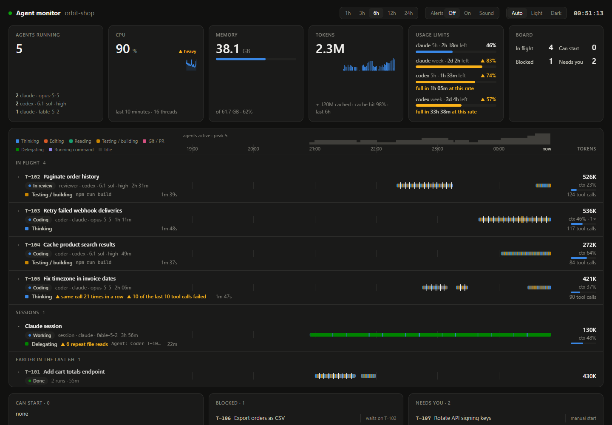
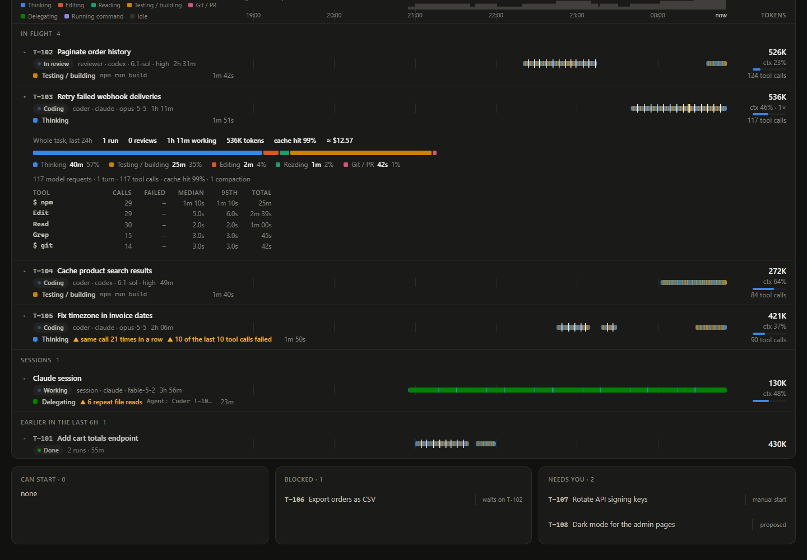
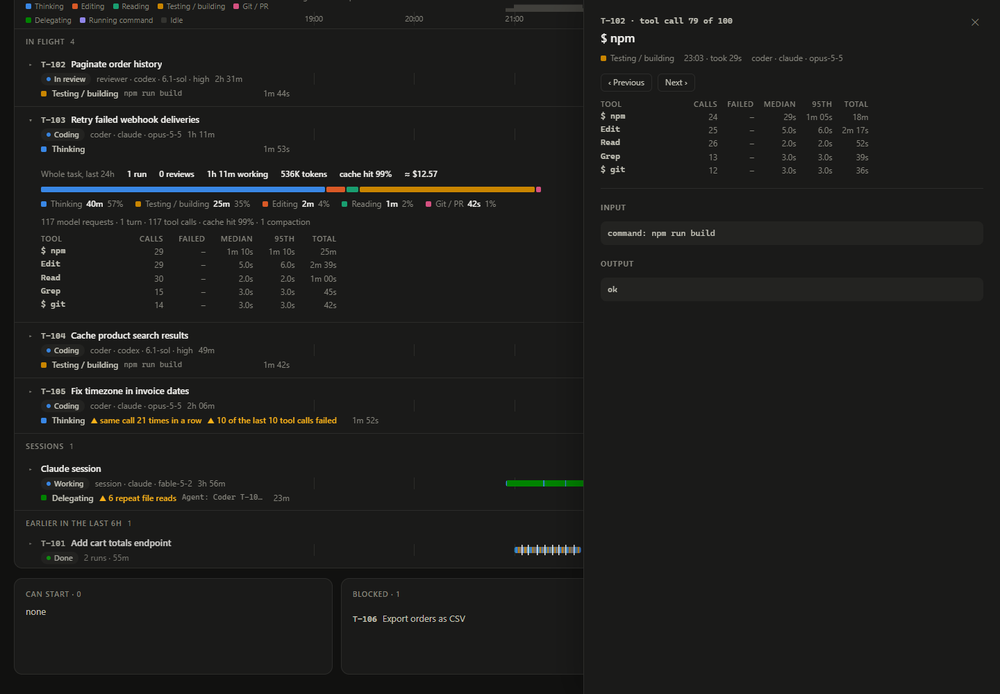

# agent-monitor

A live local dashboard for coding agents working a task board. It reads what the agents already write to disk and shows, per task, who is on it, what they are doing right now, a timeline of the last hours, tokens and context use, plus machine CPU, memory and account usage limits.



The screenshots show invented data from `node tools/demo.mjs`.

Read-only, no dependencies, Node 22 or newer. It listens on 127.0.0.1 only, because the page shows prompts, commands and tool output from local transcripts. Reaching it from another device needs a tunnel and a sign-in (Remote access, below).

## Run

```
node server.mjs <project folder | config.json> [--port 4599] [--hours 24] [--no-gh]
```

For example `node server.mjs ~/code/my-project`, then open http://127.0.0.1:4599. One server watches one project; run a second one on another port for another project.

To look around before pointing it at a project, run `node tools/demo.mjs`, or `/monitor-demo` in Claude Code. It writes an invented project to a temporary folder, keeps its agents working for as long as it runs, and serves the dashboard on it at port 4600. See Demo, below.

A project folder may hold its own `.agent-monitor.json`; it is read when the folder is the argument. Config files kept in `projects/` here are ignored by git, so personal paths stay out of the repository. If the port is taken the server moves to the next free one and prints it.

## As a Claude Code plugin

The repository is also a plugin and its own marketplace. From a local checkout:

```
/plugin marketplace add <path to this folder>
/plugin install agent-monitor@agent-monitor
```

It adds three skills. Depending on the Claude Code version they are typed as `/setup-monitor`, `/monitor` and `/monitor-demo`, or with the plugin name in front: `/agent-monitor:setup-monitor`.

- `setup-monitor` makes a project ready (next section).
- `monitor` starts the server for the current project and gives the URL.
- `monitor-demo` runs the dashboard on invented data (Demo, below).

## Setting up a project

Claude Code and Codex already write transcripts, so activity, tokens and timelines show with no setup. Setup adds the naming that ties each run to a task.

In Claude Code, open the project and run `/setup-monitor`. Without the plugin, or for a Codex-only project:

```
node tools/setup.mjs <project folder>           # preview, writes nothing
node tools/setup.mjs <project folder> --write
```

It writes three things and reports what the dashboard will find:

- A marked "Agent dashboard conventions" section at the end of `AGENTS.md`, which Codex and other agents read. The file is created if missing.
- `CLAUDE.md` importing `AGENTS.md` if the project has none. An existing `CLAUDE.md` that does not import it gets the same section.
- A task card template in the project's task folder (`docs/tasks`, `tasks` or `.tasks`, or a new `tasks`).

Running it again replaces the section in place and touches nothing else. From then on, agents that follow the project instructions name the card when they start work, and `/monitor` shows their runs under that task. `skills/monitor/references/contract.md` has the full list of what a project provides.

## Demo

```
node tools/demo.mjs [--theme theme.json] [--port 4600]
```

The demo shows about three hours of invented history at once and then keeps going: agents start, call tools, finish and hand over to reviewers, and new tasks keep arriving. Some agents are made to get stuck so the warnings show. Usage limits rise and reset on a loop. CPU and memory are the real machine's, and there is no pull request data. None of your own transcripts are read.

A theme file sets the project name and task topics:

```json
{"name": "my-project", "tasks": [{"title": "Add cart totals endpoint", "area": "cart"}]}
```

It needs at least four tasks. In Claude Code, `/monitor-demo <subject>` has Claude write a theme about the subject first, so `/monitor-demo pokemon` gives a board of Pokémon tasks.

## What it reads

| Data | Source |
|---|---|
| Claude Code sessions and subagents | `~/.claude/projects/<project slug>/*.jsonl` and `<session>/subagents/` |
| Codex runs, per account | `~/.codex*/sessions/**/rollout-*.jsonl` whose working folder belongs to the project |
| Codex usage limits | the `rate_limits` field in those transcripts |
| Task cards (optional) | Markdown files with front matter (`id`, `title`, `status`, `agent`, `branch`, `pr`, `depends_on`, `dispatch`) under `tasksDir` |
| Pull requests (optional) | `gh pr list`, once a minute |
| CPU and memory | Windows "% Processor Utility" through `typeperf` (the Task Manager figure), `os.cpus()` elsewhere |

A run is tied to a task by the first known card id in its prompt or description, or through the PR it reviews. Without cards, any `ABC-123` style id in the prompt is used.

## Config

A JSON file; only `project` is required.

| Key | Default | Meaning |
|---|---|---|
| `project` | | Repository folder |
| `name` | folder name | Shown in the header |
| `tasksDir` | `docs/tasks`, `tasks` or `.tasks` if present | Task cards, relative to the project |
| `hours` | 24 | How far back transcripts are loaded |
| `limitWarn` | 80 | Usage-limit percentage that turns the meter to a warning |
| `testPattern` | | Extra regular expression for commands that count as testing or building |
| `prices` | Claude and OpenAI list prices | Dollars per million tokens by model, for the cost estimate: `{"gpt-6": {"in": 2, "out": 10, "cached": 0.2}}`. Keys match as substrings of the model id |
| `github` | true | Poll pull requests with `gh` |
| `port` | 4599 | |
| `passwordFile` | `~/.agent-monitor/password` | Remote-access password file |
| `accessFile` | `~/.agent-monitor/access.json` | Cloudflare Access settings file |

Card statuses follow `proposed | ready | claimed | in-review | changes-requested | needs-human | done`.

## Cost of running it

Transcripts are tailed: each poll (every 2 seconds) stats the known files and parses only appended bytes. New files and cards are looked for every 10 seconds, pull requests every 60. The page is pushed changes over one event stream and redraws once a second.

## Warnings and alerts

- **Context**: each live agent shows how full its context window is, with a count of compactions. Compactions are also marked on the timeline.
- **Going in circles**: a live agent is flagged when it makes the same tool call three or more times in a row, when half of its last ten tool calls failed, or when a quarter of its file reads repeat an earlier read.
- **Limit forecast**: each usage limit shows the time left until it resets. When the last hour's rise would fill it before the reset, it shows the time until full.
- **Whole-task rollup**: expanding a task shows its runs, reviews, working time, tokens and estimated cost across every loaded run.
- **Alerts**: the Alerts switch in the header raises a browser notification, and optionally a sound, when a task starts needing you, an agent stops responding or trips a warning, or a limit passes `limitWarn` or is forecast to fill early. Alerts also show on the page, so they work when notifications are blocked.

Claude transcripts do not name the context window. The monitor uses the sizes Anthropic publishes for Claude Code: 1M tokens for Fable, Opus 4.7 and later, Sonnet 5 and later, and Haiku 5.5. Older models count as 200K, or 1M once a request has used more than 200K, because their 1M variant is opt-in. For Codex, a shell exit code of 1 is not counted as a failure, because search commands return it for "no match".

## Tool calls





- **Statistics**: expanding a row lists each tool with its calls, failures, median and 95th percentile duration, and total time. Shell commands are grouped by the program they run, such as `$ git`.
- **Detail**: clicking a timeline opens the tool call at that moment, with its input and output and buttons to step to the previous and next call. The text is read from the transcript only when opened, and is cut at 40,000 characters.
- **Cache hit rate**: the share of input tokens read from the prompt cache, per run, per task and on the Tokens tile.

## Pull requests

Clicking a PR number opens it in the side panel: description, checks, reviews and comments, and the changed files with their diffs. It is fetched through `gh` only when opened and kept for 30 seconds. Short diffs open on their own; the rest open on a click. A file's diff is cut at 800 lines, and GitHub returns no diff at all for very large pull requests. The arrow beside the number opens the pull request on GitHub.

## Remote access

The server listens on this computer only. To reach it from elsewhere, point a tunnel such as Cloudflare Tunnel at `http://127.0.0.1:4599`. The page is also served at `/agents.html`.

- Requests made on this computer need no sign-in.
- Requests relayed by a tunnel or proxy need a Cloudflare Access sign-in or the password. With neither set up they are refused.
- A visitor who arrives over plain HTTP is sent to HTTPS before any sign-in.
- **Cloudflare Access**: put an Access application in front of the address, then save its team name and audience tag in `~/.agent-monitor/access.json` as `{"team": "<team name>", "aud": "<audience tag>", "emails": ["<allowed email>"]}`. The server checks the signed token Access adds to every request: its signature, team, audience, expiry and, when `emails` is given, the email. Leave `emails` out to accept everyone the Access policy lets in. The file is read at startup.
- **Password**: sent as HTTP Basic sign-in with any user name.
- Set the password in the `AGENT_MONITOR_PASSWORD` variable, or as the first line of `~/.agent-monitor/password`. It is read at startup.
- Five wrong passwords from one address lock that address out for 15 minutes.

The page shows prompts, commands, tool output and diffs. Prefer Cloudflare Access; if you use the password, make it long and random. A tunnel started by hand stops with its terminal, so run it as a service for an always-on address.

## Limits

- Activity is inferred from transcript events. "Thinking" means the model is generating or the agent is waiting on the API; a tool call is "running" until its result is written.
- A run with no new output for 10 minutes while thinking, or 2 hours inside a tool call, is shown as stopped.
- CPU is for the whole machine, not per agent.
- Cost is an estimate at API list prices, shown as a tooltip on token counts. It is not what a subscription plan charges. Models with no price set show no estimate; add them under `prices`.
- Claude usage limits are not in the transcripts. They appear once the status line helper is installed (below).
- Agents that leave no local transcript (cloud runs) appear through their card and PR only.

## Claude usage limits

Claude Code passes plan limits (5-hour and 7-day windows) only to a status line command. `tools/claude-statusline.mjs` saves them to `~/.agent-monitor/claude-limits.json`, which the monitor reads. Add it to `~/.claude/settings.json`:

```json
"statusLine": {"type": "command", "command": "node <path to this folder>/tools/claude-statusline.mjs"}
```

The file is refreshed while a terminal `claude` session is open; the limits are for the whole account, so one open session is enough.

## Tests

```
node --test
```

## License

MIT. Free to use, copy, change and share.
